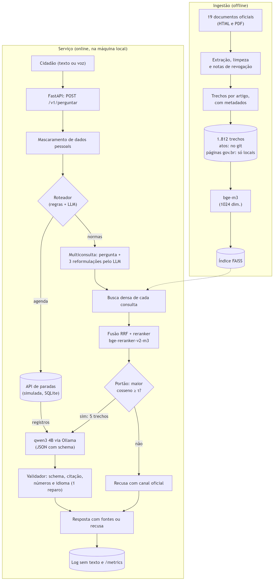

# Relatório técnico: Luz Cidadã

FIAP, Global Solution 2026.2 (CitizenTech), disciplina *Generative AI for Engineering*.
Repositório: https://github.com/pemenezes/GS_IA

## 1. Integrantes

| Nome | RM |
|---|---|
| Anny Carolina | RM98295 |
| Henrique Lima | RM551528 |
| Pedro Menezes | RM97432 |

## 2. Ficha técnica e tarefa da IA

| Campo | Conteúdo |
|---|---|
| Produto | **Luz Cidadã**, assistente de direitos do consumidor de energia elétrica |
| Cidadão e território | Moradores da Região Metropolitana de São Paulo, com prioridade para idosos, pessoas com deficiência, famílias com equipamento elétrico de saúde em casa e famílias de baixa renda |
| Problema | Na hora do apagão ou da conta absurda, o cidadão não sabe o que a distribuidora é obrigada a fazer, em quanto tempo e como reclamar |
| Proposta de valor | Respostas em linguagem simples, com a fonte oficial citada, sobre direitos e prazos, mais o aviso de paradas programadas no bairro. Quando a base não sabe, o assistente diz isso e aponta o canal oficial, em vez de inventar |
| Modelos | qwen3 4B instruct (Q4_K_M) no Ollama; bge-m3 (busca densa); bge-reranker-v2-m3 (reordenação) |
| Fontes | 19 documentos oficiais (seção 4) e uma agenda de paradas **simulada**, calibrada com dados abertos da ANEEL |
| Execução | Totalmente local, numa GPU de 6 GB (RTX 2060), sem API paga |

**Tarefa da IA** (`docs/tarefa_ia.md`): dada uma pergunta em linguagem natural de um cidadão leigo
sobre seus direitos como consumidor de energia elétrica, responder somente com base em documentos
oficiais, em linguagem simples, citando o trecho e a fonte; se a base não contém a resposta, recusar
explicitamente e apontar o canal oficial. Para perguntas sobre paradas programadas, consultar a API
de manutenções e citar o registro consultado.

**As seis perguntas da proposta** (resposta completa em `docs/ficha_tecnica.md`):
1. **Quem é o cidadão?** O morador da RMSP que depende da energia para viver com segurança e tem
   dificuldade de entender a regulação.
2. **Qual problema?** As regras são públicas, mas espalhadas em normas longas (a REN 1.000 tem
   centenas de artigos); IA genérica responde com segurança e pode inventar prazos.
3. **Como funciona?** O assistente busca os trechos nas normas, o LLM local escreve a resposta
   citando o trecho, e um validador confere a citação; sem base, recusa. Para paradas, um agente
   consulta a API.
4. **Quais tecnologias?** Python, Ollama, sentence-transformers, FAISS, FastAPI, Pydantic, SQLite,
   pytest, Docker.
5. **Quem participa?** ANEEL e distribuidoras (fontes e canais), Procon e consumidor.gov.br, a rede
   de assistência social (CRAS, CadÚnico) para divulgação.
6. **Como medir e ampliar?** Hoje: acerto com fonte, recusa correta e alucinação, comparando o LLM
   sozinho, o RAG e o agente. No produto: atendimentos e encaminhamentos. Para ampliar: dados reais
   das distribuidoras, voz e leitura da conta de luz.

**ODS conectados:**

| ODS | Como o projeto contribui |
|---|---|
| 3: Saúde e bem-estar | Direitos de quem depende de equipamento elétrico de saúde (aviso individual de interrupção, Tarifa Social) e aviso de parada programada |
| 10: Redução das desigualdades | Linguagem simples e tolerância a perguntas por voz; informação sobre Tarifa Social e Desconto Social para quem tem direito |
| 11: Cidades e comunidades sustentáveis | Em apagões e eventos climáticos na RMSP, o cidadão sabe o que exigir e como reclamar |
| 9: Indústria, inovação e infraestrutura | IA confiável e de baixo custo, local, aplicada a um serviço de infraestrutura essencial |
| 7: Energia limpa e acessível *(complementar)* | O mais direto para o tema; fora da lista sugerida, pendente de confirmação do professor |

## 3. Diagrama do pipeline

Fonte do diagrama: `docs/img/pipeline.mmd` (Mermaid).

| Componente | O que faz | Onde |
|---|---|---|
| Ingestão | Baixa, extrai e limpa os documentos, separa as notas de redação (como as de revogação) e divide em trechos por artigo, com metadados | `src/ingestao/`, `scripts/construir_base.py` |
| Índice | Embeddings bge-m3 (1024 dimensões, normalizados) em FAISS, busca exata | `src/rag/denso.py`, `scripts/construir_indices.py` |
| Roteador | Decide entre normas, agenda ou as duas; regras de reserva quando o LLM falha | `src/agente/roteador.py` |
| Multiconsulta (M) | O LLM escreve 3 reformulações no vocabulário das normas; cada uma é buscada, os rankings são fundidos por RRF e o reranker reordena pela pergunta original; 5 trechos | `src/rag/multiconsulta.py` |
| Portão de recusa | Recusa antes do LLM se o maior cosseno entre as consultas fica abaixo de τ = 0,6635 | `src/rag/pipeline.py` |
| LLM | qwen3 4B, temperatura 0, saída restrita a um JSON Schema | `src/rag/pipeline.py`, `src/rag/prompt.py` |
| Validador | Confere schema, se a citação existe no trecho, se os números estão nos trechos e o idioma; 1 reparo, senão recusa | `src/rag/validador.py` |
| API de paradas | Agenda simulada (793 eventos, 96 distritos), FastAPI e SQLite, escrita com chave | `src/paradas_api/` |
| Serviço | `POST /v1/perguntar`, `/health`, `/metrics`, página de teste; mascara dados pessoais | `src/servico/` |

## 4. Base de conhecimento

1.812 trechos de 19 documentos, consultados em 07/11/2026. Os atos oficiais têm o original e os
trechos versionados, com sha256. As páginas do gov.br estão sob CC BY-ND 3.0: o repositório guarda
só o link e o hash, e os trechos são gerados localmente (`base/fontes.csv` traz todos os campos).

| ID | Documento | Órgão | Formato | Licença | Trechos |
|---|---|---|---|---|---|
| D01 | REN ANEEL nº 1.000/2021 (texto compilado) | ANEEL | HTML | ato oficial | 1.124 |
| D02 | Lei nº 12.212/2010 (Tarifa Social, compilada) | Presidência | HTML | ato oficial | 17 |
| D03 | Lei nº 15.235/2025 | Presidência | HTML | ato oficial | 12 |
| D04 | Portaria Interministerial MME/MS nº 630/2011 | MME e MS | PDF | ato oficial | 6 |
| D05 | REN ANEEL nº 1.147/2025 | ANEEL | HTML | ato oficial | 9 |
| D06 | REN ANEEL nº 1.137/2025 | ANEEL | HTML | ato oficial | 17 |
| D07 | PRODIST, Módulo 8 (qualidade do fornecimento) | ANEEL | PDF | ato oficial | 190 |
| D08 | PRODIST, Módulo 9 (ressarcimento de danos elétricos) | ANEEL | PDF | ato oficial | 74 |
| D09 | Lei nº 14.300/2022 (micro e minigeração distribuída) | Presidência | HTML | ato oficial | 67 |
| D10 | CDC, Lei nº 8.078/1990, Título I | Presidência | HTML | ato oficial | 85 |
| D11 | Lei nº 13.460/2017 (usuário de serviço público) | Presidência | HTML | ato oficial | 32 |
| D12 | PRORET, Submódulo 6.8 (bandeiras tarifárias) | ANEEL | PDF | ato oficial | 29 |
| D13 | PRODIST, Módulo 4 (procedimentos operativos) | ANEEL | PDF | ato oficial | 36 |
| D14 | ANEEL: Como resolver, principais dúvidas | ANEEL | HTML | CC BY-ND 3.0 | 21 |
| D15 | ANEEL: perguntas frequentes sobre bandeiras | ANEEL | HTML | CC BY-ND 3.0 | 18 |
| D16 | ANEEL: Tarifa Social | ANEEL | HTML | CC BY-ND 3.0 | 7 |
| D17 | MME: Programa Luz do Povo | MME | HTML | CC BY-ND 3.0 | 21 |
| D18 | ANEEL: reclame da distribuidora e canais | ANEEL | HTML | CC BY-ND 3.0 | 40 |
| D19 | ANEEL: micro e minigeração distribuída | ANEEL | HTML | CC BY-ND 3.0 | 7 |

A agenda de paradas é simulada: as durações, os horários e os tipos foram calibrados com as
interrupções programadas reais da Enel SP em 2025 (dados abertos da ANEEL, ODbL), e os bairros são
os 96 distritos do município (IBGE). Detalhes em `docs/dados_simulados.md`.

## 5. Performance

**Protocolo.** Os conjuntos de teste foram congelados com hash antes de qualquer execução sobre
eles, e cada configuração rodou neles uma única vez. As escolhas (modelo, limiar, correções) foram
feitas no dev ou na calibração. A acurácia oficial é a da **conferência manual**, resposta a
resposta: a do test foi feita pelo Pedro; as do T2, do T3 e das correções, pelo assistente de IA que
apoiou o desenvolvimento, e validadas pelo Pedro. Todos os números trazem o IC de Wilson de 95%,
porque as amostras são pequenas.

| Conjunto | Perguntas | Papel |
|---|---|---|
| dev | 24 (16 respondíveis) | escolhas |
| test | 36 (26 respondíveis) | placar oficial |
| T2 | 24 (18 respondíveis) | escrito antes das melhorias da Fase 8B |
| T3 | 24 (18 respondíveis) | escrito depois da escolha do sistema oficial, sobre temas novos |
| calibração | 45 | comportamento de recusa |

### 5.1 Busca e limiar de recusa

| Busca original (densa, 3 trechos) | dev | test |
|---|---|---|
| recall@1 | 12/16 (75%) | 11/26 (42%) |
| recall@3 | 15/16 (94%, IC 72% a 99%) | 17/26 (65%, IC 46% a 81%) |

O recall cai do dev para o test, sobretudo nas perguntas coloquiais e de voz. Na Fase 8B, a busca
foi refeita com múltiplas consultas: nas 60 respondíveis do T1 e do T2, o recall passou de 44/60
(73%) para **52/60 (87%, IC 76% a 93%)**, e nas perguntas de voz, de 3/9 para 7/9
(`avaliacao/busca/variantes.csv`).

**Limiar.** O portão recusa quando o cosseno do melhor trecho fica abaixo de τ. O critério,
escolhido pelo Pedro, foi o maior acerto das respondíveis com no máximo 5% das perguntas fora do
domínio passando (dev e calibração). Na busca original, τ = 0,6038 aceitou 90% das respondíveis e
4% das fora do domínio. Na multiconsulta, com o maior cosseno entre as consultas, o mesmo critério
deu τ = 0,6635.

### 5.2 Placar

| Medida (manual) | C0: LLM sozinho | C1: RAG | C2: RAG + agente | **C2+M (oficial)** |
|---|---|---|---|---|
| Corretas no test | 0/26 | 13/26 (50%) | 13/26 (50%) | 19/26 (73%) \* |
| Corretas no T2 | — | — | 10/18 (56%) | 12/18 (67%) \* |
| **Corretas no T3 (limpa)** | — | — | 9/18 (50%, IC 29% a 71%) | **14/18 (78%, IC 55% a 91%)** |
| Corretas, test + T2 + T3 | — | — | 32/62 (52%, IC 39% a 64%) | 45/62 (73%, IC 60% a 82%) |
| Respostas que afirmam algo falso (soma) | 8/8 no test | 6/20 no test | 12/51 (24%) | 13/59 (22%) |
| Recusa correta (não consta e fora do domínio) | 7/7 | 7/7 | 15/15 | 15/15 |
| Perguntas da agenda | 0/3 | 0/3 | 7/7 | 7/7 |
| Latência p95 | 5,2 s | 8,3 s | 11,8 a 12,7 s | 18,5 a 19,5 s |
| VRAM de pico | 4,2 GB | 4,2 GB | 4,3 GB | 5,6 GB |

\* Pós-seleção: a multiconsulta foi escolhida olhando a busca no test e no T2.

**Interpretação.**
- **A base de normas é o que dá utilidade ao modelo.** Sozinho, o qwen3 4B não acerta nenhuma das 26
  perguntas do test (seção 6). Com a base, o C1 acerta metade, sempre citando um trecho conferível.
- **O agente acrescenta a agenda sem mudar as normas.** C1 e C2 empatam nas perguntas de normas; o
  C2 acerta todas as perguntas sobre paradas, e o roteador acertou as 36 decisões do test.
- **A multiconsulta é a melhoria que se sustentou fora de onde foi escolhida.** No T3, o C2+M acerta
  7 perguntas que o C2 erra e perde 2; a direção é a mesma nos três conjuntos. Com 18 perguntas, o
  T3 sozinho não confirma a diferença com 95% de confiança (McNemar exato, p = 0,18).
- **Outras tentativas não se sustentaram** (notebook 07): modelos maiores (qwen3 4B q8, 4B
  thinking, 8B e qwen3.5 9B) não acertaram mais e foram de 2 a 15 vezes mais lentos na GPU de
  6 GB; a autoverificação criou afirmações falsas; um pacote de correções escolhido no dev (14/16)
  empatou com o original no T2. A lição é que melhorias escolhidas num conjunto pequeno precisam ser
  confirmadas num conjunto que não participou da escolha.
- **Por tipo de pergunta** (soma dos três conjuntos, C2+M): diretas 21/25, coloquiais 12/17,
  multi-trecho 6/10, voz 6/10. No C2 original, a voz ficava em 3/10.

**Metas do plano:** JSON válido em 100% e recusa correta acima de 90% foram atingidos. A recusa
indevida ficou em 1/26, 0/18 e 2/18 no C2+M (meta de até 10%). A citação correta pela métrica
automática foi de 18/25, 14/18 e 16/16 (meta de 85%). A latência p95 do C2+M, de cerca de 19 s,
passou da meta inicial de 15 s; na escolha final, o limite aceito pelo Pedro foi de 60 s.

## 6. Alucinações do LLM sozinho (C0) e comparação

Sem a base, o C0 não acertou nenhuma das 26 perguntas respondíveis do test. O erro mais comum não
foi inventar um número: **17 das 18 recusas negaram um direito que existe**. As 8 respostas que deu
afirmavam algo falso. Exemplos reais do test, lado a lado com o sistema oficial:

| Pergunta | C0 (LLM sozinho) | C2+M (com a base) |
|---|---|---|
| T-024: "Sou aposentado e recebo o BPC. Tenho direito a algum desconto na conta de luz?" | "Não há desconto oficial na conta de luz para aposentados ou beneficiários do BPC." | Sim: quem recebe o BPC tem direito à Tarifa Social (cita a página da ANEEL sobre a Tarifa Social). |
| T-006: prazo para pedir ressarcimento de aparelho danificado | "Não há norma específica sobre prazo para ressarcimento." | Até 5 anos da data provável do dano (cita a REN 1.000). |
| T-015: o que significa a bandeira verde | "A energia vem de fontes renováveis, como solar ou eólica." (inventado) | Condições favoráveis de geração, sem acréscimo na conta. |
| T-011: critério de renda da Tarifa Social | "O CadÚnico não define critério de renda para a Tarifa Social." | Até meio salário mínimo por pessoa; até 3 salários mínimos em caso de equipamento elétrico de tratamento. |
| T-021: dias de aviso antes do corte por falta de pagamento | "72 horas de aviso." | "Três dias" (também errado; o certo são 15 dias; ver o erro 1 da seção 7) |

Para um idoso, ouvir que um direito não existe é tão grave quanto ouvir um prazo errado. O último
exemplo mostra que o sistema oficial também erra; a diferença é que a resposta dele cita o trecho
usado, o que permite conferir.

## 7. Os 5 erros

Das 13 falhas do C2 no test, o Pedro escolheu 5 representativas. Análise completa, com as entradas
e as saídas, no notebook 06.

| Erro | Entrada | Saída do C2 | Causa-raiz | Correção proposta | Efeito medido (C2+M) |
|---|---|---|---|---|---|
| T-021 | Aviso antes do corte por falta de pagamento | "três dias" (o certo é 15) | O art. 360 não veio; a página da ANEEL que veio traz 3 dias (razões técnicas) e 15 dias (falta de pagamento) na mesma frase, e o modelo pegou o da situação errada | Identificar a situação do consumidor antes de escolher o prazo; dividir páginas por situação; preferir o ato normativo | Não corrigiu: continua "três dias" |
| T-028 | A bandeira vermelha é taxa a mais? | "Não é taxa a mais" | O trecho certo veio em 3º; o modelo seguiu a página explicativa e inverteu o sentido | Responder pelo ato normativo quando as fontes divergem | Em parte: diz que o valor extra vem destacado, mas começa com "Não" |
| T-007 | Pode negar ressarcimento por emergência decretada? | Recusa por falta de informação | A regra foi revogada em 2025, mas o texto compilado ainda a mostra; o ato da revogação não veio | Mostrar as notas de revogação; tirar o texto revogado do índice | Piorou e depois melhorou em parte: com o reranker, chegou a afirmar a regra revogada; o C2+M diz "não", mas a apresenta como exceção válida |
| T-039 | Prazos do resultado e do pagamento do ressarcimento | Só o primeiro prazo | Faltou o segundo trecho (fragmentação) | Reranker e mais trechos | Corrigido: 15 e 20 dias |
| T-011 | Critério de renda da Tarifa Social | "até 3 salários mínimos" | Veio só a exceção, apresentada como regra geral | Reranker e multiconsulta | Corrigido: regra geral e exceção |

**O que os erros mostram.** Dois foram corrigidos por uma busca melhor: quando o trecho certo chega,
o modelo de 4B responde certo. Os três que continuam são de interpretação: o número ou a regra está
em algum trecho, mas é de outra situação, contradiz o ato normativo ou foi revogado, e por isso a
verificação automática não detecta. Os dois erros do C2+M no T3 seguem o mesmo padrão (regra geral
sem a exclusão da classe residencial; prazos de sistemas isolados no lugar do prazo comum).

## 8. Segurança, LGPD e IA responsável

Resumo de `docs/lgpd_e_ia_responsavel.md`:
- **Minimização:** tudo roda localmente; CPF, CNPJ, telefone, e-mail, CEP e números longos são
  mascarados antes do modelo e dos registros. Nomes e endereços não são detectados (limitação).
- **Registros:** só um hash da pergunta e dados técnicos; nunca o texto da pergunta ou da resposta.
- **Credenciais:** apenas no `.env`, fora do git; a escrita na API de paradas exige chave.
- **Transparência:** toda resposta cita a fonte; a recusa explica o motivo; aviso fixo de que a
  orientação é informativa; a agenda é rotulada como simulada.
- **Licenças:** o texto das páginas gov.br (CC BY-ND 3.0) não é versionado nem entra na imagem
  Docker.
- **Robustez:** perguntas coloquiais e com ruído de voz foram avaliadas à parte (seção 5.2).
- **Prompt injection:** 5 tentativas no C1 e no C2; nenhuma fez o assistente abandonar as regras.
- **Humano no circuito:** o assistente orienta e aponta o canal oficial; não decide nem protocola.

## 9. Conclusão, limitações e próximos passos

Um LLM de 4B, rodando numa GPU de 6 GB, sozinho não serve para orientar o cidadão: nega direitos que
existem. Com busca nas normas, citação verificável, portão de recusa e validador, o mesmo modelo
acerta cerca de 3 em cada 4 perguntas (78% no teste limpo), recusa corretamente o que não está na
base e responde sobre a agenda de paradas. As melhorias que funcionaram foram as de busca; trocar o
modelo por outro maior não compensou nesse hardware.

**Limitações.**
- Cerca de 1 em cada 5 respostas ainda afirma algo falso, em geral por interpretação; a citação e o
  aviso mitigam, mas não eliminam o risco.
- A base é um recorte de 19 documentos de 07/11/2026; normas mudam.
- A agenda é simulada.
- Os conjuntos de teste são pequenos, e os intervalos de confiança, largos.
- A latência de cerca de 19 s é alta para uma conversa.

**Próximos passos.**
1. Um passo que identifique a situação do consumidor antes de escolher o prazo.
2. Tirar da base o texto revogado, ou juntar a revogação ao trecho.
3. Ampliar o conjunto de teste para estreitar os intervalos.
4. Integrar com o MVP do projeto: entrada por voz e leitura da conta de luz por OCR (os campos
   `origem` e `contexto` da API já existem) e dados reais de paradas das distribuidoras.

## 10. Links

- Repositório: https://github.com/pemenezes/GS_IA
- Vídeo de demonstração: *(a incluir)*
