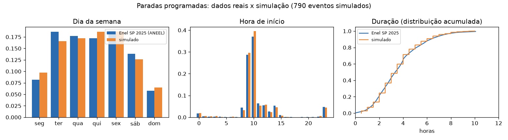

# Dados simulados: API de paradas programadas

A API de paradas programadas (`src/paradas_api/`) responde "vai ter desligamento programado no
bairro X no dia Y?". É a ferramenta que o agente (C2, Fase 7) consulta para as perguntas
dinâmicas. **Os dados são simulados**, mas os horários, as durações e o volume seguem as
interrupções programadas reais da Enel SP.

## Por que simular

Não há fonte pública que permita consultar paradas **futuras** por bairro de forma automatizada
e reprodutível:
- a página de manutenção programada da Enel SP exige o número da instalação e não tem API
  pública;
- os dados abertos da ANEEL trazem só interrupções já ocorridas, por conjunto elétrico, sem
  bairro;
- a API prevista no item 113 do PRODIST Módulo 4 é de uso exclusivo da ANEEL.

O gabarito também precisa ser congelado e reprodutível: uma fonte real mudaria a resposta certa
das perguntas dinâmicas a cada dia. Por isso a decisão (Pedro, 08/11/2026) foi simular,
**calibrar com dados reais** e deixar a fonte atrás de uma interface (`FonteParadas`) que
permita trocá-la.

## Calibração com dados abertos da ANEEL

- **Conjunto:** [Interrupções de Energia Elétrica nas Redes de Distribuição](https://dadosabertos.aneel.gov.br/dataset/interrupcoes-de-energia-eletrica-nas-redes-de-distribuicao),
  arquivo de 2025, o último ano completo (Parquet, 9,7 milhões de registros).
- **Licença:** ODbL 1.0. *Contém dados da ANEEL (dadosabertos.aneel.gov.br), sob a licença
  ODbL.*
- **Filtro:** Enel Distribuição São Paulo (sigla `ELETROPAULO` nos dados) e tipo `Programada`.
  São 11.053 registros e 8.705 ordens de interrupção. Cada par (ordem, conjunto elétrico) conta
  como uma parada sentida naquele conjunto: 8.813 pares em 143 conjuntos. Foram descartados 3
  pares com duração inválida.
- **Script:** `scripts/calibrar_paradas.py`. O arquivo original (272 MB) fica em
  `base/local/aneel/`, fora do git. Só os agregados vão para `src/paradas_api/calibracao.json`,
  com o sha256 do arquivo.

| Parâmetro | Valor (Enel SP, 2025) |
|---|---|
| Paradas por conjunto elétrico por dia | 0,169 |
| Dia da semana | seg 8%, ter 19%, qua 18%, qui 17%, sex 19%, sáb 14%, dom 6% |
| Hora de início | 66% às 9h ou 10h; 5% às 23h (manutenção noturna) |
| Duração | mediana 3,3 h; 10% abaixo de 1,5 h e 10% acima de 6,3 h |
| Peso do mês (média = 1) | out 0,85; nov 0,82; dez 0,53 |

## Como o gerador funciona (`src/paradas_api/gerador.py`)

1. **Bairros:** os 96 distritos oficiais do município de São Paulo, da API de localidades do IBGE
   (`src/paradas_api/distritos_sp.json`). Simplificação: **bairro = distrito**.
2. **Janela:** 30 dias antes e 30 dias depois da data de referência (terça-feira, 10/11/2026).
3. **Volume:** para cada dia e distrito, o número de paradas é sorteado de uma Poisson com média
   igual a 0,169 × peso do dia da semana × peso do mês. Cada distrito faz o papel de um conjunto
   elétrico.
4. **Horário:** a hora de início é sorteada da distribuição real, com minuto 0 ou 30. A duração
   vem da distribuição empírica real, arredondada para 30 minutos, com mínimo de 30 minutos.
5. **Semente 42** (`config.yaml`): o mesmo comando gera sempre o mesmo arquivo. Os testes
   conferem o hash.

O resultado tem **793 paradas** (3 delas são âncoras):
- **Por status:** 382 concluídas, 374 agendadas e 37 canceladas.
- **Por tipo:** 475 manutenções, 194 obras e 124 podas.

O CSV versionado é `dados/paradas_simuladas.csv` (sha256 `bbe7efde…`). O banco
`dados/paradas.sqlite` é recriado a partir dele e não vai para o git.

### Suposições (os dados reais não trazem essa informação)

Aprovadas pelo Pedro em 09/11/2026:
- **Tipo:** 60% manutenção programada, 25% obra e 15% poda. Nos dados da ANEEL, o fato gerador
  das programadas da Enel SP é sempre "INTERNA; PROGRAMADA; ALTERACAO; PARA MELHORIA".
- **Cancelamento:** 5% das paradas. Os dados só registram interrupções que aconteceram.
- **Status:** calculado em relação às 8h de 10/11/2026: concluída se já terminou, em andamento se
  já começou, agendada se ainda não começou.
- **Motivo:** textos genéricos por tipo, como "Poda de árvores próximas à rede".
- **Criação:** de 3 a 15 dias antes do início, como um aviso prévio.

## Registros-âncora e garantias do gabarito

As 6 perguntas dinâmicas do conjunto de teste (`avaliacao/teste.jsonl`, tipo `dinamica`)
dependem do que a API devolve. Para o gabarito não depender de sorteio, o gerador **sempre** cria
os registros abaixo. Nos mesmos bairro e data, não cria nenhuma outra parada. Os horários são
locais (America/Sao_Paulo); no banco eles ficam em UTC.

| id | Bairro | Data | Início | Fim | Tipo | Status | Pergunta |
|---|---|---|---|---|---|---|---|
| PAR-ANC-01 | Vila Mariana | 2026-11-11 | 09:00 | 13:00 | manutencao_programada | agendada | T-055 |
| PAR-ANC-02 | Mooca | 2026-11-10 | 13:00 | 17:00 | obra | agendada | T-056 |
| PAR-ANC-03 | Santana | 2026-11-13 | 08:00 | 12:00 | poda | agendada | T-057 |

**Ausências garantidas:** nenhuma parada, em nenhum status, no Butantã em 11/11/2026 (T-058) e na
Lapa em 13/11/2026 (T-059).

**Ambiguidade:** quatro distritos começam com "Jardim" (Jardim Helena, Jardim Paulista,
Jardim São Luís e Jardim Ângela). Assim, "no Jardim", sem complemento, é ambíguo, e o agente
deve pedir o nome completo (T-060).

## A API (`src/paradas_api/app.py`, Apêndice B.2)

| Rota | O que faz |
|---|---|
| `GET /paradas?bairro=&data=&status=` | Paradas que tocam aquele dia (horário local). O bairro é comparado sem acento e sem maiúsculas; um nome desconhecido devolve `bairro_encontrado: false` |
| `GET /paradas/{id}` | Um registro (404 se não existir) |
| `GET /bairros?q=` | Bairros que contêm o texto, para o agente detectar ambiguidade |
| `POST /paradas`, `PATCH /paradas/{id}` | Escrita, com header `X-API-Key` igual a `PARADAS_API_KEY` |
| `GET /health` | Status, número de registros e sha256 dos dados |

**Detalhes de comportamento:**
- **Horários:** cada registro traz os horários em UTC (`inicio_utc`, `fim_utc`) e em horário
  local (`inicio_local`, `fim_local`).
- **Madrugada:** uma parada das 23h às 3h aparece na consulta dos dois dias.
- **Chave de API:** a comparação usa `hmac.compare_digest`. Sem chave configurada, ou com o valor
  de exemplo do `.env.example`, a escrita fica desligada (503). A escrita altera só o SQLite; o
  CSV continua sendo a semente reprodutível.

## Limitações

- **Bairro = distrito:** um distrito tem vários bairros populares (por exemplo, a Vila Clementino
  fica na Vila Mariana). A comparação aproximada de nomes e a tradução de bairro para distrito
  ficam para o agente (Fase 7).
- **Só a capital:** a Enel SP também atende 23 outros municípios da RMSP. Uma consulta sobre eles
  devolve "bairro não encontrado".
- **Volume e horários são estatísticos:** o conjunto elétrico da ANEEL não coincide com o
  distrito, e a taxa por conjunto foi aplicada a cada distrito.
- **Tipo, cancelamento e motivo são suposições.**
- **Não é a agenda real:** o assistente sempre indica a página oficial de manutenção programada
  da distribuidora, onde o cidadão confirma com o número da instalação.

## Como trocar por dados reais

O agente usa só o protocolo `FonteParadas` (`src/paradas_api/fonte.py`), com dois métodos:
`buscar(bairro, data)` e `bairros(q)`. Uma fonte real precisaria apenas implementar esse
contrato e mapear os campos do Apêndice B.2. Exemplos: um acordo de dados com a distribuidora,
ou o acesso à API do PRODIST Módulo 4, item 113. Nem o agente nem o gabarito mudam; só as
perguntas dinâmicas precisariam de um novo gabarito, porque a resposta certa passaria a depender
da data.
